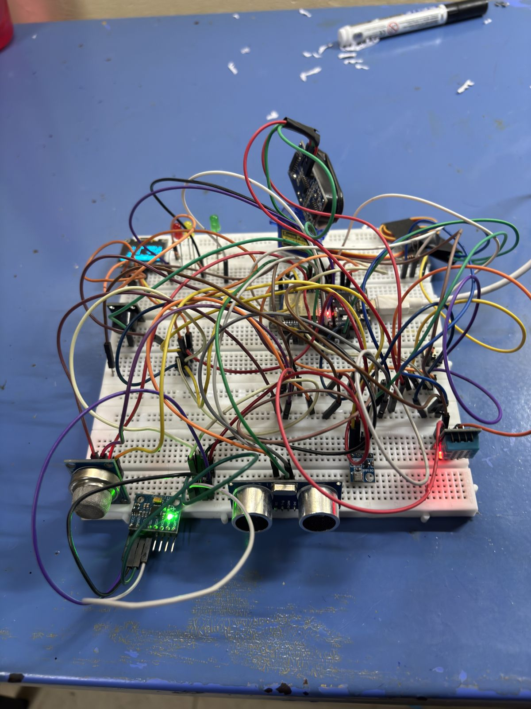

# AeroLab

AeroLab is an ESP32-based environmental and motion sensing station built with PlatformIO. It combines multiple sensors into a single firmware with a web dashboard, buzzer/LED alerts, and night-mode behavior.



## Features

- **Motion & orientation**: MPU6050 (accelerometer/gyroscope)
- **Barometric pressure/altitude**: BMP180
- **Temperature & humidity**: DHT11
- **Gas sensing**: MQ FC-22
- **Light sensing**: LDR + photodiode
- **Distance sensing**: 2× HC-SR04 ultrasonic (fixed + servo-mounted radar sweep)
- **Remote input**: IR receiver (VS1838B)
- **Output**: OLED display, 7-segment display (74HC595), RGB LED, buzzer, servo
- **Connectivity**: WiFi with WebSocket-based live data + `data/index.html` dashboard (Three.js visualization)
- Night mode automatically silences ultrasonic proximity beeps while keeping LED status active

## Hardware / Wiring

Full pin-by-pin wiring notes are documented as comments at the top of [`src/main.cpp`](src/main.cpp), covering the I2C bus, DHT11, dual HC-SR04 sensors, servo, LDR, gas sensor, IR receiver, buzzer, RGB LED, and 7-segment display.

## Getting Started

This project uses [PlatformIO](https://platformio.org/).

1. Install PlatformIO (VS Code extension or CLI).
2. Clone this repo and open it in PlatformIO.
3. Copy the config template and fill in your own values:
   ```bash
   cp data/config.example.json data/config.json
   ```
   Then edit `data/config.json` with your WiFi SSID/password and alert thresholds. **This file is gitignored — never commit real credentials.**
4. Connect your ESP32 board, update `upload_port` / `monitor_port` in `platformio.ini` to match your system, and build/upload:
   ```bash
   pio run --target upload
   pio run --target uploadfs   # uploads data/ (dashboard + config) to LittleFS
   ```
5. Open the serial monitor at 115200 baud, or connect to the device's WiFi-served dashboard.

## Project Structure

```
src/            Firmware source (main.cpp)
include/        Header files
lib/            Project-specific libraries
data/           Files uploaded to the ESP32 filesystem (dashboard, config template)
test/           PlatformIO unit tests
docs/           Abstract/writeup and reference photos
```

## Docs

See [`docs/Abstracts-1.pdf`](docs/Abstracts-1.pdf) for the project abstract/writeup.

## License

Add a license of your choice (MIT is a common default for hobby hardware projects).
