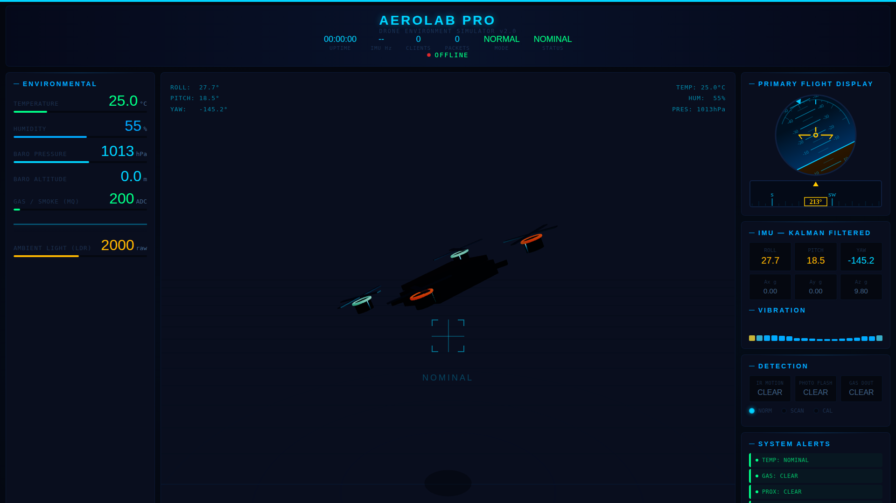

<div align="center">

# 🛰️ AeroLab Pro

### A breadboard-based Hardware-in-the-Loop simulator for drone sensor design — before you build the drone.

[](https://www.espressif.com/en/products/socs/esp32)
[](https://platformio.org/)
[](#-live-telemetry-dashboard)
[](#license)


*The breadboard sensor rig — and the live dashboard it drives:*



</div>

---

## Why AeroLab Pro exists

Building and testing a real drone is expensive, and it's risky — a mis-tuned sensor threshold or a bad mounting angle can end in a crashed frame, a broken flight controller, and a burnt weekend. That cost is a real barrier for students and hobbyists who just want to learn *how* flight sensors behave before committing to an airframe.

**The idea behind AeroLab is simple: simulate the drone's sensory environment on the bench first.**

Instead of straight away buying motors, an ESC, a frame, and a flight controller, AeroLab reproduces a drone's entire sensor stack — IMU, altitude, obstacle ranging, environment sensors — on a breadboard driven by a single ESP32. You physically tilt, rotate, and move the board to mimic real flight dynamics (roll/pitch/yaw, altitude change, an obstacle coming into range), and watch exactly how each sensor responds, in real time, on a live 3D dashboard.

This lets you answer the questions that actually determine a drone's reliability *before* a single propeller spins:
- Where should each sensor physically sit on the frame?
- What alert/failsafe thresholds (proximity, tilt, temperature, gas) actually make sense?
- Which sensor is noisy, which is slow, and which needs filtering (e.g. Kalman on the IMU)?
- How does the whole stack behave together, not just in a datasheet?

Once that's validated cheaply on a breadboard, the exact same sensor layout and thresholds can be carried over to a custom PCB and then to the actual flight build — so the expensive part only happens once, with confidence. That's the plan this project is working towards: **breadboard simulation → PCB → drone**, in that order, to keep the cost of learning low.

---

## 🖥️ Live Telemetry Dashboard

Every sensor reading streams over WiFi (WebSocket) to a browser-based "glass cockpit" — a live 3D drone model that mirrors the physical board's orientation, a Primary Flight Display with artificial horizon, a radar sweep map, and real-time alerts for every monitored parameter. *(See the preview at the top of this page.)*

> The dashboard also runs in a self-contained **demo mode** with simulated data whenever no board is connected — so you can open `data/index.html` in a browser and see the full interface working, even without hardware.

---

## What it simulates

| Drone system | Simulated using | Purpose |
|---|---|---|
| Attitude (roll / pitch / yaw) | MPU6050 IMU + Kalman filtering | Flight stability sensing |
| Altitude & obstacle avoidance | 2× HC-SR04 ultrasonic (one on a servo for a 180° radar sweep) | Ranging & collision-avoidance logic |
| Environmental health | BMP180 (pressure/altitude), DHT11 (temp/humidity), MQ FC-22 (gas/smoke) | Payload / airframe safety limits |
| Ambient conditions | LDR + photodiode | Night-mode / light-based behavior |
| Remote input | IR receiver (VS1838B) | Command & control testing |
| Local feedback | OLED, 7-segment display, RGB LED, buzzer, servo | Standalone alerts without a laptop |

## ✨ Features

- **Motion & orientation**: MPU6050 (accelerometer/gyroscope)
- **Barometric pressure/altitude**: BMP180
- **Temperature & humidity**: DHT11
- **Gas sensing**: MQ FC-22
- **Light sensing**: LDR + photodiode
- **Distance sensing**: 2× HC-SR04 ultrasonic (fixed + servo-mounted radar sweep)
- **Remote input**: IR receiver (VS1838B)
- **Output**: OLED display, 7-segment display (74HC595), RGB LED, buzzer, servo
- **Connectivity**: WiFi with WebSocket-based live data + `data/index.html` "glass cockpit" dashboard (Three.js 3D drone, PFD, radar sweep, live alerts)
- **Configurable thresholds**: temperature, humidity, gas, proximity, and altitude alert limits — all editable without touching firmware
- **Night mode**: automatically silences ultrasonic proximity beeps while keeping LED status active

## 🔌 Hardware / Wiring

Full pin-by-pin wiring notes are documented as comments at the top of [`src/main.cpp`](src/main.cpp), covering the I2C bus, DHT11, dual HC-SR04 sensors, servo, LDR, gas sensor, IR receiver, buzzer, RGB LED, and 7-segment display.

## 🚀 Getting Started

This project uses [PlatformIO](https://platformio.org/).

1. Install PlatformIO (VS Code extension or CLI).
2. Clone this repo and open it in PlatformIO.
3. Copy the config template and fill in your own values:
   ```bash
   cp data/config.example.json data/config.json
   ```
   Then edit `data/config.json` with your WiFi SSID/password and alert thresholds (temperature limit, humidity limit, buzzer on/off, etc). **This file is gitignored — never commit real credentials.**
4. Connect your ESP32 board, update `upload_port` / `monitor_port` in `platformio.ini` to match your system, and build/upload:
   ```bash
   pio run --target upload
   pio run --target uploadfs   # uploads data/ (dashboard + config) to LittleFS
   ```
5. Open the serial monitor at 115200 baud, or connect to the device's WiFi-served dashboard at `http://<device-ip>/`.

> Want to preview the dashboard without hardware? Just open `data/index.html` directly in a browser — it automatically falls back to demo mode with simulated telemetry.

## 📁 Project Structure

```
src/            Firmware source (main.cpp)
include/        Header files
lib/            Project-specific libraries
data/           Files uploaded to the ESP32 filesystem (dashboard, config template)
test/           PlatformIO unit tests
docs/           Abstract/writeup and reference photos
```

## 🗺️ Roadmap

- [x] Breadboard sensor cluster + firmware
- [x] Live WebSocket telemetry + 3D dashboard
- [ ] Move validated sensor layout to a custom PCB
- [ ] Port thresholds/config to an actual flight controller build
- [ ] Closed-loop testing on a physical airframe

## 📄 Docs

See [`docs/Abstracts-1.pdf`](docs/Abstracts-1.pdf) for the full project abstract/writeup.

## License

Add a license of your choice (MIT is a common default for hobby hardware projects).
